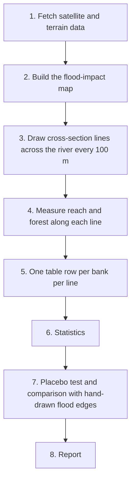

# Do riverbank forests limit how far Himalayan debris floods reach?

---

## 1. What the study asks

When a very large debris flood rushes down a Himalayan valley, it spills sideways
up the riverbanks. The question is:

**Is forest on a riverbank associated with the flood reaching less far up that
bank, after taking the shape of the terrain into account?**

The wording is always "associated with". The study is observational (we look at
what happened, we don't run an experiment), so it cannot prove that forests
_cause_ the difference.## The three variables

- **Exposure (the thing being tested): forest on the bank.**
  For each spot along the river, we look at a strip of bank 100 m wide and measure
  what share of it was forest _before_ the flood. A pixel only counts as forest if
  satellite land-cover data says "trees", the canopy is at least 5 m tall, and
  there was no recent forest loss.
- **Outcome (what the flood did): how far the flood reached.**
  Measured three ways on each bank:
  - **Reach distance:** metres from the top of the riverbank to the furthest point
    the flood left a mark.
  - **Reach height:** how many metres above the riverbed that furthest point is.
  - **Overtopped:** yes or no, meaning the flood went at least 20 m past the bank.

  The flood mark has to start within 20 m of the bank top to count. If it
  doesn't, all three are zero for that bank. Banks with zero reach stay in the
  analysis; rows are never picked or dropped based on whether they show impact.

- **Controls (things that also affect reach, so they are accounted for):** channel
  width, river steepness, valley width, slope of the valley walls and bank, size of
  the upstream catchment, which side of a river bend the bank is on, and distance
  downstream.

### What is not allowed as the outcome

**Vegetation loss (for example an NDVI drop) is never used to measure flood
impact.** Only places with plants can lose greenness, and forest has the most to
lose, so measuring impact that way would build the answer into the measurement
instead of measuring the flood. Instead, flood impact is detected from:

- **Sentinel-2 (optical satellite):** fresh bare sediment that wasn't there before.
- **Sentinel-1 (radar satellite, sees through clouds):** a strong change in the
  radar signal.

Places that were already bare before the flood are marked "unknown", because new
sediment there can't be told apart from what was already there.

### Timing rule

Forest and all controls come only from **before** the flood. Flood impact comes
only from **after** the flood. The code checks the exact time each image was taken
(not just the date) and stops if this is broken:

- **Before** images: taken before midnight UTC at the start of the flood day.
- **After** images: taken more than 12 hours after the flood started. If the
  hour of the flood isn't known, "after" starts at midnight UTC the next day.

---

## 2. The three floods studied

Each flood is analysed separately with the same code. They are never combined into
one model.

- **Melamchi, 2021** (landslide-dam flood, 15 June with a second surge 31 July to
  1 August, treated as one event). "Before" ends before 15 June; "after" starts
  3 August. The analysed stretch is the line checked in QGIS. It starts
  downstream of the 2021 debris deposit (28.05333 N, 85.53600 E) and runs
  35.549 km (35,548.6 m), meeting the Indrawati at Melamchi Bazaar, 31.221 km along the
  line. All data exists. This one is built and checked first.
- **Lende Khola, 2025** (lake-outburst flood, 8 July; hour unknown, so "after"
  starts 9 July). The analysed stretch starts at the Rasuwagadhi border crossing
  and runs 35 km downstream, along the Bhotekoshi and then the Trishuli. 35 km is
  the figure from the draft paper, kept until a better-documented end point is
  found. All data exists.
- **Bhote Koshi, 2026** (ice-rock avalanche debris flood, 26 August at 02:52 UTC).
  The analysed stretch starts at the Rasuwagadhi border crossing and runs 72 km
  downstream along the Bhotekoshi and Trishuli, or ends at Bidur if you confirm
  Bidur is nearer. This is the main test. Clear post-flood images from Oct–Dec
  2026 are still arriving. Until that window closes on 15 December 2026, its
  report is marked **PROVISIONAL**, shows how many clear images each pixel has,
  and gives **no verdict**. The final run happens after 15 December 2026.

How the stretches are defined:

- The lengths above are approximate. The analysed stretch is always the start
  and end distances in `config.yaml` (`reach_start_km` and `reach_end_km`),
  measured along your checked river line.
- Nothing past the end is analysed. Spots beyond it stay in the table but are
  marked as outside the stretch.
- Lende 2025 and Bhote Koshi 2026 use **the same river line file and the same
  starting point**, so a spot on the river has the same number in both floods.
  Each flood still uses its own before-flood channel, forest and terrain.
- The river above Rasuwagadhi is left out for both of those floods. That is where
  the flow started and gathered speed, not a river with banks to compare.
- Where another river joins inside the stretch, the stretch is split into
  **river sections** at that point. The code suggests likely joining points
  (where the upstream catchment grows by more than half within 300 m) and you
  confirm them in `config.yaml` under `section_breaks_km`. The between-places
  model then allows each section its own baseline. For any flood with a split,
  the analysis is also re-run on the first section alone (for Melamchi, the
  Melamchi River above the Indrawati), because a joining river brings its own
  flood water from the same storm.
- Once a river line is checked, the code prints how far along the river each
  named place in `config.yaml` (`landmarks`) is, so you can compare the lengths
  above with the real line.

As a check, every flood is also re-run with the end point moved 5 km upstream and
5 km downstream.

## 3. How the analysis works



1. **Fetch:** download satellite images, elevation models and land-cover data from
   Google Earth Engine for a 2 km-wide strip on each side of the river.
2. **Impact map:** mark each 10 m pixel as impacted, not impacted, or unknown.
3. **Cross-section lines:** every 100 m along the river, draw a line out to 1.5 km
   on the left and right bank.
4. **Measure:** along each line, find the bank top, how far the impact reaches, and
   how much forest is on the bank.
5. **Table:** save one row per station and bank to `transects.csv`.
6. **Statistics:** two models. One compares different places along the river; the
   other compares the left and right banks at the same spot (both banks met the
   same flood at the same moment, so many differences cancel out).

   Uncertainty is measured on **3 km blocks** of river, because spots close
   together along the river behave alike. The main method is a "wild cluster
   bootstrap". It asks how often a forest effect at least this large would show
   up by chance if the true effect were zero, and it gives a 95% range. In
   simulations with no real effect, that range included zero 93–96% of the time,
   close to the intended 95%. A flood with fewer than 8 blocks gets at most an
   "inconclusive" verdict. The older method, which resamples whole 1 km stretches,
   is still reported next to it, labelled as known to be too narrow with few
   stretches. The left-vs-right model
   only works if banks differ in forest: if fewer than 30 spots have a forest
   difference of at least 20 percentage points between the banks, it is marked
   **uninformative** for that flood.

7. **Checks:**
   - **Placebo:** run the same method on two years _without_ a flood. If it still
     finds a "forest effect", the method is producing false results. The placebo
     years are fixed in advance:
     - Melamchi 2021: Oct–Dec 2018 vs Oct–Dec 2019.
     - Lende 2025 and Bhote Koshi 2026: Oct–Dec 2022 vs Oct–Dec 2023.

     2024 is avoided because of the late-September 2024 floods in central Nepal and
     the 2025 Lende flood.

   - **Validation:** the code picks 40 random spots along the river (spread
     evenly across low, medium and high forest) and hides their forest values. You
     draw the real flood edge on both banks at those spots from independent
     high-resolution imagery, such as Google Earth Pro's historical imagery. The
     code then compares your edges with its own, overall and by forest level,
     to check that flood marks under trees are not being missed. Any published
     flood maps (for example the Copernicus EMS EMSR927 maps for 2026) are added
     alongside.

8. **Report:** a web page per flood with maps, figures and a verdict.

### Possible verdicts (fixed before seeing results)

- **Consistent with a protective association:** forest goes with less reach, in
  both models and in every check.
- **No evidence of association:** no clear link, _and_ the uncertainty is tight
  enough to rule out anything but a small effect. "Tight enough" is fixed in
  advance: for reach distance and height, the whole uncertainty range for going
  from 0% to 100% forest must fall within a quarter of a standard deviation
  of the outcome either way. For overtopping, the odds must stay between 0.67
  and 1.5 times.
- **Inconclusive:** anything else. This includes no clear link but wide
  uncertainty, mixed signs, too little data, a failed placebo, an uninformative
  left-vs-right model, or no validation data.

---

## 4. Folder layout

Everything lives in the project folder,
`C:\Users\babyz\Documents\Flood-mapping\`:

```
Flood-mapping/
  info.md               this file
  CURSOR_BUILD_SPEC.md  the full technical rules for building the code
  research-premise.md   background notes (the spec overrides its second half)
  terminology.md        glossary of Earth-observation terms
  prompts.md            phase-by-phase prompts for building the code in Cursor
  config.yaml           all settings: dates, thresholds, paths, Earth Engine project
  requirements.txt      list of Python libraries to install
  src/floodforest/      the code
  tests/                automatic checks on small made-up data
  data/<event>/         downloaded and cached data per flood
  outputs/<event>/      results per flood: transects.csv, figures, report.html
  outputs/summary_report.html   the three floods side by side
```

`<event>` is one of `melamchi2021`, `lende2025`, `bhotekoshi2026`.

`config.yaml`, `src/`, `tests/`, `data/` and `outputs/` don't exist yet; they are
created when the code is built.

---

## 5. One-time setup (Windows)

### 5.1 Install Python 3.11

1. Download Python 3.11 or newer from <https://www.python.org/downloads/>.
2. While installing, tick **"Add Python to PATH"**.

### 5.2 Create the project's own Python environment

A virtual environment keeps this project's libraries separate from the old project.
Open PowerShell and run:

```powershell
cd "C:\Users\babyz\Documents\Flood-mapping"
py -3.11 -m venv .venv
.venv\Scripts\Activate.ps1
```

If PowerShell refuses to run the last line, run this once and try again:

```powershell
Set-ExecutionPolicy -Scope CurrentUser RemoteSigned
```

When it works, the prompt starts with `(.venv)`. **Do the `cd` and `Activate`
lines every time you open a new terminal for this project.**

### 5.3 Install the libraries

```powershell
pip install -r requirements.txt
pip freeze > requirements.lock.txt
```

The second line records the exact versions installed so results can be reproduced.

### 5.4 Google Earth Engine

1. Sign in at <https://earthengine.google.com/> with a Google account.
2. Create (or reuse) a Google Cloud project registered for **noncommercial** Earth
   Engine use. A billing account must be attached, but noncommercial use is not
   charged.
3. In PowerShell (with `(.venv)` active) run:

   ```powershell
   earthengine authenticate
   ```

4. Put the project ID into `config.yaml` under `ee_project`.

---

## 6. Things you need to provide

The code will stop and say what's missing if any of these aren't in place.

- **Earth Engine project ID** in `config.yaml`.
- **Two checked river lines.** One for Melamchi
  (`data/melamchi2021/centerline.geojson`) and one shared by Lende 2025 and Bhote
  Koshi 2026 (`data/rasuwagadhi_trishuli/centerline.geojson`), starting at the
  Rasuwagadhi border crossing. The code can draft each from OpenStreetMap; you
  then correct it in QGIS against the pre-flood satellite image and add the
  property `"verified_by_user": true`. The code refuses to use an unchecked line.
- **End points.** Lende 2025 is set to 35 km for now; replace it if you find a
  better-documented end point. For Bhote Koshi 2026, say whether Bidur is nearer
  than 72 km. Melamchi is already set to the length of the checked line.
- **Where rivers join inside the Lende and Bhote Koshi stretches**
  (`section_breaks_km`). Use `[]` if none. Melamchi is already set: the
  Indrawati joins at 31.221 km, which is also Melamchi Bazaar.
- **Coordinates for the named places** under `landmarks` (Rasuwagadhi,
  Syaphrubesi, Betrawati, Bidur), so the code can show their distance along the
  river. Melamchi Bazaar and the Melamchi–Indrawati confluence are already set.
- **`exclusions.geojson`** marking dams and reservoirs to leave out.
- **Hand-drawn flood edges for every flood.** Once the code has written
  `data/<event>/validation/sample_stations.geojson` (40 spots), draw the flood edge
  on both banks at each spot and save it as `validation_edges.geojson` in the same
  folder. Without these, that flood's verdict can be at most "inconclusive".
- **Published flood maps if you have them,** for example the Copernicus EMS
  EMSR927 products for 2026, downloaded into `data/bhotekoshi2026/validation/`.
- **Confirmation that no notable flood hit the river in the placebo years**
  (2018–2019 for Melamchi, 2022–2023 for the other two).
- **Dates to skip** if a later flood spoiled some post-flood images
  (`exclude_dates` in `config.yaml`).

---

## 7. Running it

With `(.venv)` active and inside `Flood-mapping/`, each step is run like this:

```powershell
python -m floodforest.cli <step> --event <event>
```

Steps, in order:

- `fetch` downloads the data and lists every satellite image used.
- `label` builds the flood-impact map.
- `transects` draws the cross-section lines.
- `profiles` measures along each line.
- `table` builds `transects.csv`.
- `stats` runs the models.
- `validate` compares the code's flood edges with your hand-drawn ones (and any
  published maps).
- `placebo` runs the no-flood test.
- `report` builds `report.html`.

Or run everything at once with `all`. For example:

```powershell
python -m floodforest.cli fetch --event melamchi2021
python -m floodforest.cli all --event melamchi2021
```

Each step saves its results in `data/` so it can be re-run on its own without
redoing earlier steps.

To run the automatic checks:

```powershell
pytest
```

### Build order and pause points

1. Set up the project and get all the automatic tests passing on made-up data.
2. Run `fetch` for Melamchi 2021. **You check the centerline in QGIS.**
3. Run `label`. **Pause: you look at the impact maps before continuing.**
4. Run `transects`, `profiles`, `table`. **Pause: you look at six example
   cross-sections.**
5. Run `stats`, `placebo`, `validate`, `report` for Melamchi.
6. Repeat for Lende 2025, then Bhote Koshi 2026.
7. Build the summary report.

---

## 8. Known limitations (will appear in every report)

- **Observational design:** it shows associations, not causes.
- **Flood marks hidden under trees:** if the flood passed under surviving canopy,
  the satellites may not see it, which would make forests look more protective
  than they are. The validation step tests for this.
- **Harvested fields** can look like fresh sediment.
- **Coarse elevation data:** 30 m elevation models in a narrow gorge, made before
  the flood changed the riverbed.
- **Old tree-height map:** the canopy height layer is from 2020, so forest that
  grew taller than 5 m after 2020 is counted as non-forest. A check re-runs the
  analysis with forest defined by land cover alone and reports how often the two
  definitions disagree.
- **Unmeasured factors** such as soil type, past disturbance, and forest tending to
  be where fewer people live.
- **Only three floods.**
